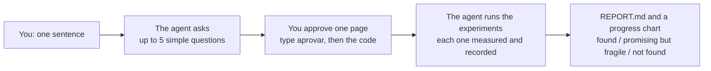

# honestlab

**Test your idea the way AI labs make discoveries, from the Claude Code, Codex or Copilot subscription you already have.**

*English · [Português](README.pt-BR.md)*

Say you have a hunch: *"I could predict my sales better if I used the weather."* honestlab turns
that sentence into an honest experiment. Your coding agent builds the test, tries many versions
on its own, and gives you a one-line verdict you can trust. You do not need to code or to know
statistics. You answer a few questions and approve one page.

> **Verdict: Found.** A real improvement over the best known method, confirmed on new data and
> by an independent review.
>
> *In plain words:* the model using the weekday, holidays, temperature and rain missed by 18.6
> units a day on the months kept for the final test. Your current average missed by 52.8, and
> the best simple known method by 27.5. Careful: your data has the weather that actually
> happened, but in real life you would only have the forecast, so the real gain should be
> smaller.
>
> <sub>Shortened from the `REPORT.md` of a real test run on an ice-cream shop's sales file,
> translated from Portuguese. The agent wrote the caveat without being asked.</sub>

## Start in 3 steps

**1. Install once.** In Claude Code, type:

```text
/plugin install honestlab --marketplace FrancyJGLisboa/honestlab
```

That is all. Your computer needs Python 3.9 or newer and git, which most Macs and Linux machines
already have. Using Codex CLI or Copilot CLI instead? See [other agents](#other-agents).

**2. Open your agent in a folder** that holds your data (a spreadsheet or a CSV file), or in a
project you already have.

**3. Say what you want to find out:**

```text
Use honestlab: I think I can predict next week's sales from the weather better than I do today.
```

No idea yet? Inside a project, say `Use honestlab: what could we discover here?`. The agent then
suggests options in plain words.

## What happens next



The page you approve is written in your language. It says what the question is, how the answer
will be measured, what it will be compared with, and what counts as success. To approve it, you
type `approve` (or `aprovar`) in the chat. honestlab itself, not the agent, then shows you the
page and a 4-digit code that only you can see. You send it back, for example `yes 4821`, and the
agent carries on. If something must change later, you type `unlock` (or `destrancar`) and confirm
the same way. In Claude Code you never need a terminal.

From that moment, nobody can change the question, the measure, the data or the success rule,
not even the agent. That is the whole trick. The bar is set before anyone sees the results, and
part of the data stays locked until the very end, so neither luck nor wishful thinking can
produce a "discovery".

## Is my question a good fit?

It fits when a computer can score each attempt with a number, and you have data or a program to
score it on.

| Fits | Does not fit |
|---|---|
| "Can the weather improve my sales forecast?" | "Which logo looks better?" (no number a computer can calculate) |
| "Is there a faster way to schedule these deliveries?" | "Will this law pass?" (no data to test against) |
| "Can this crop model predict yields better?" | "Is my business plan good?" (many goals, no single measure) |
| "Can this function run faster on our real inputs?" | Anything whose data does not exist yet (a survey, a field trial, next season's harvest) |

## What the verdict means

| Verdict | Meaning | Typical next step |
|---|---|---|
| **Found** | It beat the best known method by the margin you agreed to, on the locked data, and survived an independent review. | Have someone from the field check it, then test it on the next period of data before you rely on it. |
| **Promising but fragile** | There are signs of a gain, but they did not hold up with confidence. | Test it on the next period, or get more data. |
| **Not found** | Nothing beat the best known method by the agreed margin. | This is a useful answer: your current method held up against an honest search. |

honestlab compares your idea with the **best known method**, not just with what you do today.
Beating a weak starting point is easy. The report tells you whether you found something better
than what is already known.

## Questions people ask

**Do I need to code?** No. The agent writes all the code. You answer a few questions, read one
page, and approve it with two short messages.

**How much of my subscription does it use?** It runs inside your normal agent session. By
default the agent tries up to 15 changes, and each one is an ordinary agent step plus a
measurement. The cost on each plan has not been measured yet.

**How long does it take?** The two recorded test runs took 4 to 5 minutes from start to finish,
with only a few experiments. A full run takes longer, depending on how slow your measurement is.
You can also ask the agent to run all night: after you approve, it keeps experimenting until the
time you set, and you stop it early by typing `parar` or `stop`.

**Where does my data go?** honestlab itself makes no network calls. Your agent reads your files the
same way it does in any other session, under your agent's usual terms.

**Does it tell me whether the result is new?** It tells you what a search found, and it shows
the search. Before a result can count as found, the agent must record at least 3 searches in at
least 2 sources, with the date and a link for every related work, and the independent reviewer
runs one search of its own. The report then says "already known", "similar work exists" or
"nothing similar found", next to the verdict. Finding nothing does not prove a result is new, and
honestlab checks the form of the search, not that it was complete. Whether the result is useful is
measured: it must beat the best known method by the margin you chose.

**Can someone else check the result?** Yes, with one command. Anyone with the lab folder runs
`honestlab reproduce F001`. honestlab copies the lab from its history into a new folder, checks
that nothing protected changed, measures everything again with the frozen evaluator, and says
whether the verdict is the same.

**Will I understand the report?** We tested it. A model playing a person with no technical
training read 8 real reports, 3 times each, and explained them in its own words. 22 of 24
explanations had the right verdict and only true numbers. With the same results as an
autoresearch-style log (one row per attempt), 5 of 24 did. A model is not a person, so this is a
first check, not proof. [Details](usability/RESULTS.md).

**Will the rules stop creative ideas?** The rules limit what can be called a finding, not what the
agent may try. It may change anything in the editable code, and every undone attempt is kept and can
be tested again later. You choose how free the search is: **explore** keeps every attempt that looks
better, so the agent can build on small or uncertain gains; **prove** keeps only gains that are
unlikely to be luck. In both, "found" needs proof on held-out data. The cost is real: with noisy
data, a true gain close to the margin is often reported as "not found"
([calibration](stress/RESULTS.md)). "Not found" means "not proven with this data", not "false".

**Can the agent cheat?** honestlab is built for an agent that means well but may cut corners or
overclaim, and it makes cheating hard and visible. When you approve, the measuring code, the data
and the success rule are fingerprinted and made read-only, and honestlab's own records must match
what it committed; any change is detected and blocks further results. While the agent's code is
measured, honestlab watches for it reading the locked data or starting other programs. We also
told agents to defeat honestlab on purpose: most attacks were blocked or caught, those that
worked were fixed, and two limits remain: honestlab cannot check who wrote the "independent"
review, and an agent deliberately trying to cheat, running as your user, can still get around
checks that run inside the same program. [The stress test](stress/RESULTS.md) has every attack
and result.

**Why do I approve, and not the agent?** Because approving is the moment the rules become fixed.
The approval code is shown only to you and never sent to the agent, and honestlab blocks the
obvious ways for the agent to approve by itself. It also checks the conversation for your own
confirmation message: if it cannot find it, the report says so and will not say "Found".

## Try it with a ready-made example

Open Claude Code in an empty folder and say:

```text
Use honestlab: set up the bin packing example and run it.
```

The example is online bin packing, one of the problems DeepMind's FunSearch worked on. You will
still approve the page yourself.

To see it train a model, say `Use honestlab: set up the character model example and run it.`
The agent improves a small neural network that guesses the next letter of *Dom Casmurro*. Every
run trains for 60 seconds on your CPU, and the network must beat a classic counting method on
chapters it never saw. It needs numpy.

## Other agents

For Codex CLI or Copilot CLI (or Claude Code without plugins), install the command once:

```bash
pipx install git+https://github.com/FrancyJGLisboa/honestlab
honestlab setup        # teaches Codex, Copilot and Claude Code the honestlab skill
```

Then use it the same way. The only difference: you approve by opening a terminal in the folder,
typing `honestlab freeze`, and then `yes` (or `sim`).

## Why this works: what AI labs do

DeepMind's FunSearch (2023) and AlphaEvolve (2025) found new algorithms with a simple recipe. An
automatic program scores every attempt, a model proposes attempt after attempt in a loop, and
the best ones are kept. honestlab gives that recipe to one person and one agent. It also adds the
safeguards science uses so it does not fool itself: the success rule is written down in advance,
some data is held back for the end, and someone who did not do the work reviews the result.
Every `REPORT.md` ends with a table that matches each step to the corresponding part of the
labs' recipe.

honestlab applies the same discipline at a much smaller scale, so it will not find what
AlphaEvolve finds. What it does is tell you honestly whether your idea holds up.

## Evidence so far

- **Usability.** In tests with the plugin and a real Claude Code agent, simulated
  non-technical users typed 4 to 5 messages each (the fifth was a follow-up question), ran no
  terminal commands, never got stuck on jargon, and always got a plain-language report. Before
  the 0.4 redesign it took 4 messages and 2 or 3 terminal commands, each user got stuck on jargon
  once, and neither got a report. The first plugin run also exposed a bug when approving twice,
  now fixed and covered by tests. These are single runs with simulated users, so treat them as a
  first measurement. [Details](usability/RESULTS.md).
- **Honesty benchmark.** On a small planted-flaw benchmark, plain Claude Code made no false
  claims (12 of 12 correct) and honestlab got 11 of 12. Its one error came from a honestlab bug that
  is now fixed. So honestlab has not yet been shown to reduce false claims. The benefits that were
  observed concern the process: clean use of the test data and an explicit comparison with
  known methods. [Details](bench/RESULTS.md).
- **Stress test.** Six hard simulated people (no real signal, nothing to measure, a Brazilian
  Excel export, an English speaker, someone approving too early, someone pushing to lower the bar
  after a "not found") were all handled correctly, and the agent refused to move the bar. Agents told to
  defeat honestlab found real holes, now fixed; two limits remain (see above). In 400 simulated
  labs per scenario with no real effect, honestlab never said "found"; when a real improvement
  existed but was smaller than the agreed margin, it said "found" up to 15% of the time, and the
  report now warns when that is possible. [Details](stress/RESULTS.md).
- **Training noise.** On the character model example, 14 one-setting changes were trained 6
  times each. The rule "one run, keep if lower", which autoresearch uses, kept 10 changes: 4 really
  helped on chapters no rule saw, and 5 were noise, including both copies of the unchanged code.
  honestlab's earlier rule kept the same 10. honestlab now trains each attempt 3 times and counts
  that variation: it kept 5, of which 4 really helped. One task, one machine.
  [Details](stress/RESULTS.md).
- **Machine speed.** With training limited in seconds, a busy computer trains less. In a live
  check, a starting point measured while the computer was busy made an unchanged model look 6.1%
  better later, and it was kept. With `"remeasure_best": true`, honestlab measures the current best
  again next to each change, and the same unchanged model was discarded. One check, one machine.
  [Details](stress/RESULTS.md).
- **Tests.** 51 hook decisions in the formats of the three agents, 83 end-to-end cases, 48 cases
  for approving and unlocking in the chat and for the plugin, 17 replays of the attacks from the
  stress test, 73 robustness cases (malformed evaluator output, damaged records, odd paths, two
  runs at once, native libraries, run-to-run noise, undeclared packages, explore and prove modes), 24 overnight mode cases, 17 ablation cases, 11 reproduction cases,
  30 machine-speed drift cases, 22 explain-back checker cases, 36 measure cases (AUC, F1, RMSE, median, days in time order), 12 fake-test cases, 26 event-test cases, 18 follow-up question cases and 9 sanity-check cases
  (`bash tests/run_all.sh`). Every claim on
  this page is mapped to the command that checks it in [VERIFICATION.md](VERIFICATION.md).

**Status: early (0.5).** Tested live with Claude Code 2.1 on Linux, including the plugin and
approving in the chat. Codex CLI and Copilot CLI were tested only through their documented hook
formats, and Windows is untested. Reports from real
use are very welcome.

## Learn more

- [How it works](docs/how-it-works.md): the discipline step by step, the statistics, and what is
  enforced and how strongly.
- [Reference](docs/reference.md): commands, files, the evaluator contract, using honestlab on an
  existing repository, and the test suite.

## License

MIT
