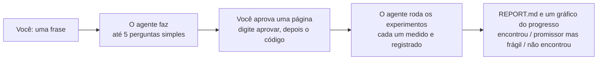

# honestlab

**Teste sua ideia do jeito que os laboratórios de IA fazem descobertas, com a assinatura do Claude Code, Codex ou Copilot que você já tem.**

*[English](README.md) · Português*

Imagine que você tem um palpite: *"eu preveria melhor minhas vendas se usasse o tempo"*. O
honestlab transforma essa frase num experimento honesto. Seu agente monta o teste, tenta muitas
versões sozinho e te entrega um veredito de uma linha em que você pode confiar. Você não
precisa programar nem saber estatística. Você responde a algumas perguntas e aprova uma página.

> **Veredito: Encontrou.** Uma melhora real sobre o melhor método conhecido, confirmada em dados
> novos e por uma revisão independente.
>
> *Em palavras simples:* um modelo com dia da semana, feriado, temperatura e chuva errou 18,6
> unidades por dia nos meses guardados para a prova final, contra 52,8 da sua média e 27,5 do
> melhor método simples conhecido. Cuidado: nos seus dados o tempo é o que realmente aconteceu,
> e na vida real você teria só a previsão do dia, então o ganho real deve ser menor.
>
> <sub>Trecho, encurtado, do `REPORT.md` de um teste real com a planilha de vendas de uma
> sorveteria. O agente escreveu o alerta sem ninguém pedir.</sub>

## Comece em 3 passos

**1. Instale uma vez.** No Claude Code, digite:

```text
/plugin install honestlab --marketplace FrancyJGLisboa/honestlab
```

Só isso. O computador precisa ter Python 3.9 ou mais novo e git, que a maioria dos Macs e das
máquinas Linux já tem. Usa o Codex CLI ou o Copilot CLI? Veja [outros agentes](#outros-agentes).

**2. Abra o agente numa pasta** com seus dados (uma planilha ou um arquivo CSV), ou num projeto
que você já tem.

**3. Diga o que quer descobrir:**

```text
Use honestlab: acho que dá para prever as vendas da próxima semana usando o tempo, melhor do que faço hoje.
```

Ainda sem ideia? Dentro de um projeto, diga `Use honestlab: o que dá para descobrir aqui?`. O
agente sugere opções em palavras simples.

## O que acontece depois



A página que você aprova vem no seu idioma. Ela diz qual é a pergunta, como a resposta vai ser
medida, com o que vai ser comparada e o que conta como sucesso. Para aprovar, você digita
`aprovar` na conversa. O próprio honestlab, e não o agente, mostra a página e um código de 4
dígitos que só você vê. Você responde, por exemplo, `sim 4821`, e o agente segue sozinho. Se algo
precisar mudar depois, você digita `destrancar` e confirma do mesmo jeito. No Claude Code, você nunca
precisa do terminal.

A partir daí, ninguém muda a pergunta, a medida, os dados nem a regra de sucesso, nem mesmo o
agente. Esse é o segredo. A barra é definida antes de alguém ver os resultados, e uma parte dos
dados fica trancada até o fim. Assim, nem a sorte nem a torcida conseguem produzir uma
"descoberta".

## Minha pergunta serve?

Serve quando um computador consegue dar uma nota numérica a cada tentativa, e você tem dados ou
um programa para calcular essa nota.

| Serve | Não serve |
|---|---|
| "O tempo melhora minha previsão de vendas?" | "Qual logo é mais bonito?" (não há número que o computador calcule) |
| "Existe um jeito mais rápido de programar estas entregas?" | "Essa lei vai passar?" (não há dados para testar) |
| "Este modelo de safra consegue prever a produtividade melhor?" | "Meu plano de negócios é bom?" (muitos objetivos, nenhuma medida única) |
| "Esta função pode rodar mais rápido com nossos dados reais?" | Qualquer coisa cujos dados ainda não existem (uma pesquisa, um teste de campo, a próxima safra) |

## O que o veredito quer dizer

| Veredito | Significado | Próximo passo típico |
|---|---|---|
| **Encontrou** | Superou o melhor método conhecido pela margem que você aceitou, nos dados trancados, e passou por uma revisão independente. | Peça a alguém da área para conferir, e teste no próximo período de dados antes de confiar. |
| **Sinal promissor, mas frágil** | Há indícios de ganho, mas eles não se confirmaram com segurança. | Teste no próximo período, ou junte mais dados. |
| **Não encontrou** | Nada superou o melhor método conhecido pela margem combinada. | É uma resposta útil: seu método atual resistiu a uma busca honesta. |

O honestlab compara sua ideia com o **melhor método conhecido**, não só com o que você faz hoje.
Superar um ponto de partida fraco é fácil. O relatório diz se você achou algo melhor do que o
que já se conhece.

## Perguntas comuns

**Preciso saber programar?** Não. O agente escreve todo o código. Você responde a algumas
perguntas, lê uma página e aprova com duas mensagens curtas.

**Quanto da minha assinatura isso usa?** Roda dentro da sua sessão normal do agente. Por padrão
o agente tenta até 15 mudanças, e cada uma é um passo comum do agente mais uma medição. O custo
em cada plano ainda não foi medido.

**Quanto tempo leva?** Os dois testes registrados levaram de 4 a 5 minutos do início ao fim,
com poucos experimentos. Uma rodada completa leva mais, dependendo de quão lenta é a medição.
Você também pode pedir que o agente rode a noite toda: depois da aprovação, ele continua
experimentando até a hora que você escolher, e você para antes digitando `parar`.

**Para onde vão meus dados?** O honestlab não faz nenhuma conexão de rede. Seu agente lê seus
arquivos do mesmo jeito que em qualquer outra sessão, sob os termos de sempre do agente.

**Ele diz se o resultado é novo?** Ele diz o que uma busca encontrou e mostra a busca. Antes de
um resultado contar como achado, o agente precisa registrar pelo menos 3 buscas em pelo menos 2
fontes, com a data e o link de cada trabalho parecido, e a revisão independente faz uma busca
própria. O relatório então diz "já conhecido", "existe trabalho parecido" ou "nada parecido foi
encontrado", ao lado do veredito. Não achar nada não prova que é novo, e o honestlab confere o
formato da busca, não se ela foi completa. Se o resultado é útil, isso é medido: ele precisa
superar o melhor método conhecido pela margem que você escolheu.

**Outra pessoa consegue conferir o resultado?** Sim, com um comando. Quem tiver a pasta do
laboratório roda `honestlab reproduce F001`. O honestlab copia o laboratório do histórico para uma
pasta nova, confere que nada protegido mudou, mede tudo de novo com o avaliador trancado e diz se o
veredito é o mesmo.

**Vou entender o relatório?** Nós testamos. Um modelo fazendo o papel de uma pessoa sem formação
técnica leu 8 relatórios reais, 3 vezes cada, e explicou com as próprias palavras. 22 de 24
explicações tinham o veredito certo e só números verdadeiros. Com os mesmos resultados no formato
de registro do autoresearch (uma linha por tentativa), 5 de 24 tinham. Um modelo não é uma pessoa,
então isto é uma primeira conferência, não uma prova. [Detalhes](usability/RESULTS.md) (em inglês).

**As regras vão barrar ideias criativas?** As regras limitam o que pode ser chamado de achado, não o
que o agente pode tentar. Ele pode mudar qualquer coisa no código editável, e toda tentativa desfeita
fica guardada e pode ser testada de novo depois. Você escolhe quão livre é a busca: **explorar**
guarda toda tentativa que parecer melhor, para o agente construir em cima de ganhos pequenos ou
incertos; **provar** só guarda ganhos que dificilmente são sorte. Nos dois, "encontrei" exige prova em
dados guardados. O custo é real: com dados ruidosos, um ganho verdadeiro perto da margem muitas vezes
sai como "não encontrou" ([calibração](stress/RESULTS.md), em inglês). "Não encontrou" quer dizer "não
provado com estes dados", não "falso".

**O agente pode trapacear?** O honestlab foi feito para um agente bem-intencionado que pode
cortar caminho ou exagerar, e torna a trapaça difícil e visível. Quando você aprova, o código que
mede, os dados e a regra de sucesso recebem uma impressão digital e ficam somente leitura, e os
registros do próprio honestlab precisam bater com o que ele gravou; qualquer mudança é detectada e
trava novos resultados. Enquanto o código do agente é medido, o honestlab vigia se ele lê os dados
trancados ou abre outros programas. Também mandamos agentes tentarem derrotar o honestlab de
propósito: a maioria dos ataques foi bloqueada ou detectada, os que funcionaram foram corrigidos,
e restam dois limites: o honestlab não consegue verificar quem escreveu a revisão
"independente", e um agente tentando trapacear de propósito, rodando com o seu usuário, ainda
consegue contornar checagens feitas dentro do mesmo programa.
[O teste de estresse](stress/RESULTS.md) tem cada ataque e resultado (em inglês).

**Por que sou eu que aprovo, e não o agente?** Porque aprovar é o momento em que as regras
ficam fixas. O código de aprovação aparece só para você e nunca é enviado ao agente, e o
honestlab bloqueia os caminhos óbvios para o agente aprovar sozinho. Ele também confere, na
conversa, a sua própria mensagem de confirmação: se não a encontrar, o relatório avisa e não diz
"Encontrou".

## Experimente com um exemplo pronto

Abra o Claude Code numa pasta vazia e diga:

```text
Use honestlab: monte o exemplo de empacotamento em caixas e rode.
```

O exemplo é o empacotamento online em caixas, um dos problemas em que o FunSearch, da DeepMind,
trabalhou. A aprovação da página continua sendo sua.

Para ver o honestlab treinar um modelo, diga `Use honestlab: monte o exemplo do modelo de letras
e rode.` O agente melhora uma pequena rede neural que adivinha a próxima letra de *Dom Casmurro*.
Cada treino dura 60 segundos no processador do seu computador, e a rede precisa vencer um método
clássico de contagem em capítulos que ela nunca viu. Precisa do numpy.

## Outros agentes

Para o Codex CLI ou o Copilot CLI (ou o Claude Code sem plugins), instale o comando uma vez:

```bash
pipx install git+https://github.com/FrancyJGLisboa/honestlab
honestlab setup        # ensina a skill do honestlab ao Codex, ao Copilot e ao Claude Code
```

O uso é igual. A única diferença: para aprovar, você abre um terminal na pasta, digita
`honestlab freeze` e depois `sim`.

## Por que funciona: o que os laboratórios de IA fazem

O FunSearch (2023) e o AlphaEvolve (2025), da DeepMind, acharam algoritmos novos com uma receita
simples. Um programa automático dá nota a cada tentativa, um modelo propõe tentativa após
tentativa num laço, e as melhores são guardadas. O honestlab entrega essa receita a uma pessoa e
um agente. Ele também acrescenta as salvaguardas que a ciência usa para não se enganar: a regra
de sucesso é escrita antes, uma parte dos dados fica guardada para o fim, e alguém que não fez o
trabalho revisa o resultado. Todo `REPORT.md` termina com uma tabela que liga cada etapa à parte
correspondente da receita dos laboratórios.

O honestlab aplica a mesma disciplina numa escala muito menor, então não vai achar o que o
AlphaEvolve acha. O que ele faz é dizer, com honestidade, se a sua ideia se sustenta.

## O que já foi medido

- **Facilidade de uso.** Em testes com o plugin e um agente real do Claude Code, pessoas leigas
  simuladas digitaram de 4 a 5 mensagens cada (a quinta foi uma pergunta extra), não rodaram
  nenhum comando no terminal, não travaram com jargão e sempre receberam um relatório em
  linguagem simples. Antes da versão 0.4 eram 4 mensagens e 2 ou 3 comandos no terminal, cada
  pessoa travou com jargão uma vez, e nenhuma recebeu relatório. A primeira rodada com o plugin
  também revelou um defeito ao aprovar duas vezes, já corrigido e coberto por testes. São
  execuções únicas com pessoas simuladas, então trate como uma primeira medição.
  [Detalhes](usability/RESULTS.md) (em inglês).
- **Benchmark de honestidade.** Num benchmark pequeno com falhas plantadas, o Claude Code sozinho
  não fez nenhuma afirmação falsa (12 de 12 corretas) e o honestlab acertou 11 de 12. O único erro
  veio de um bug do honestlab, já corrigido. Ou seja, ainda não está demonstrado que o honestlab
  reduz afirmações falsas. Os benefícios observados foram de processo: uso limpo dos dados de
  teste e comparação explícita com métodos conhecidos. [Detalhes](bench/RESULTS.md) (em inglês).
- **Teste de estresse.** Seis pessoas simuladas difíceis (sem sinal nos dados, nada para medir,
  uma planilha exportada do Excel brasileiro, alguém em inglês, alguém aprovando antes da hora,
  alguém pressionando para baixar a meta depois de um "não encontrou") foram todas atendidas
  corretamente, e o agente se recusou a mudar a meta. Agentes instruídos a derrotar o honestlab
  acharam brechas reais, já corrigidas; restam os dois limites acima. Em 400 laboratórios
  simulados por cenário sem efeito real, o honestlab nunca disse "encontrou"; quando havia uma
  melhora real, mas menor que a meta combinada, disse "encontrou" em até 15% das vezes, e agora o
  relatório avisa quando isso é possível. [Detalhes](stress/RESULTS.md) (em inglês).
- **Ruído do treino.** No exemplo do modelo de letras, 14 mudanças de um ajuste cada foram treinadas 6
  vezes. A regra "um treino, guarda se ficou menor", que o autoresearch usa, guardou 10 mudanças: 4
  ajudaram de verdade em capítulos que nenhuma regra viu, e 5 eram ruído, incluindo as duas cópias do
  código sem mudança. A regra anterior do honestlab guardou as mesmas 10. Agora o honestlab treina
  cada tentativa 3 vezes e conta essa variação: guardou 5, das quais 4 ajudaram de verdade. Uma
  tarefa, um computador. [Detalhes](stress/RESULTS.md) (em inglês).
- **Velocidade da máquina.** Quando o treino tem um limite em segundos, um computador ocupado treina
  menos. Num teste real, um ponto de partida medido com o computador ocupado fez um modelo sem mudança
  parecer 6,1% melhor depois, e ele foi guardado. Com `"remeasure_best": true`, o honestlab mede o
  melhor atual de novo ao lado de cada mudança, e o mesmo modelo sem mudança foi descartado. Um
  teste, um computador. [Detalhes](stress/RESULTS.md) (em inglês).
- **Testes.** 51 decisões dos ganchos nos formatos dos três agentes, 83 casos de ponta a ponta, 48
  casos da aprovação e do destrancamento pela conversa e do plugin, 17 repetições dos ataques do
  teste de estresse, 73 casos de robustez (saída malformada do avaliador, registros danificados,
  caminhos estranhos, dois `run` ao mesmo tempo, bibliotecas nativas, variação entre treinos, pacotes não declarados, modos explorar e provar), 24
  casos do modo noite, 17 casos de ablação, 11 casos de reprodução, 30 casos de variação de velocidade da máquina, 22 casos do conferidor de explicação, 36 casos de medidas (AUC, F1, RMSE, mediana, dias em ordem no tempo), 12 casos de testes falsos, 29 casos do teste de evento, 18 casos de pergunta seguinte, 9 casos de conferência do avaliador, 15 casos da lista de hipóteses, 11 casos do modo pesquisador, 16 casos das regras de skill (guia da Anthropic) e 31 casos do time (`bash tests/run_all.sh`). Cada afirmação desta
  página está ligada ao comando que a confere no [VERIFICATION.md](VERIFICATION.md) (em inglês).

**Estado: inicial (0.5).** Testado ao vivo com o Claude Code 2.1 no Linux, incluindo o plugin e a
aprovação pela conversa. O Codex CLI e o Copilot CLI foram testados só pelos formatos documentados
dos ganchos, e o Windows não foi testado.
Relatos de uso real são muito bem-vindos.

## Para saber mais (em inglês)

- [Como funciona](docs/how-it-works.md): a disciplina passo a passo, a estatística, e o que é
  garantido e com que força.
- [Referência](docs/reference.md): comandos, arquivos, o contrato do avaliador, uso num
  repositório existente e a bateria de testes.

## Licença

MIT
