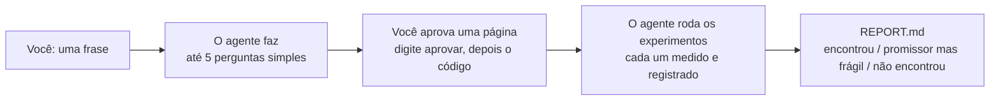

## Comece em 3 passos

**1. Instale uma vez** (você já fez este passo). No Claude Code, digite:

```text
/plugin install honestlab --marketplace FrancyJGLisboa/honestlab
```

Só isso. O computador precisa ter Python 3.9 ou mais novo e git, que a maioria dos Macs e das
máquinas Linux já tem. Usa o Codex CLI ou o Copilot CLI? Veja [outros agentes](#outros-agentes).

**2. Abra o agente numa pasta** com seus dados (uma planilha ou um arquivo CSV), ou num projeto
que você já tem.

**3. Diga o que quer descobrir:**

```text
Use honestlab: acho que dá para prever as vendas da próxima semana usando o tempo, melhor do que faço hoje.
```

Ainda sem ideia? Dentro de um projeto, diga `Use honestlab: o que dá para descobrir aqui?`. O
agente sugere opções em palavras simples.

## O que acontece depois



A página que você aprova vem no seu idioma. Ela diz qual é a pergunta, como a resposta vai ser
medida, com o que vai ser comparada e o que conta como sucesso. Para aprovar, você digita
`aprovar` na conversa. O próprio honestlab, e não o agente, mostra a página e um código de 4
dígitos que só você vê. Você responde, por exemplo, `sim 4821`, e o agente segue sozinho.

A partir daí, ninguém muda a pergunta, a medida, os dados nem a regra de sucesso, nem mesmo o
agente. Esse é o segredo. A barra é definida antes de alguém ver os resultados, e uma parte dos
dados fica trancada até o fim. Assim, nem a sorte nem a torcida conseguem produzir uma
"descoberta".
