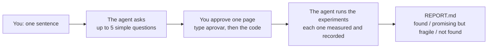

## Start in 3 steps

**1. Install once** (you already did this step). In Claude Code, type:

```text
/plugin install honestlab --marketplace FrancyJGLisboa/honestlab
```

That is all. Your computer needs Python 3.9 or newer and git, which most Macs and Linux machines
already have. Using Codex CLI or Copilot CLI instead? See [other agents](#other-agents).

**2. Open your agent in a folder** that holds your data (a spreadsheet or a CSV file), or in a
project you already have.

**3. Say what you want to find out:**

```text
Use honestlab: I think I can predict next week's sales from the weather better than I do today.
```

No idea yet? Inside a project, say `Use honestlab: what could we discover here?`. The agent then
suggests options in plain words.

## What happens next



The page you approve is written in your language. It says what the question is, how the answer
will be measured, what it will be compared with, and what counts as success. To approve it, you
type `approve` (or `aprovar`) in the chat. honestlab itself, not the agent, then shows you the
page and a 4-digit code that only you can see. You send it back, for example `yes 4821`, and the
agent carries on.

From that moment, nobody can change the question, the measure, the data or the success rule,
not even the agent. That is the whole trick. The bar is set before anyone sees the results, and
part of the data stays locked until the very end, so neither luck nor wishful thinking can
produce a "discovery".
